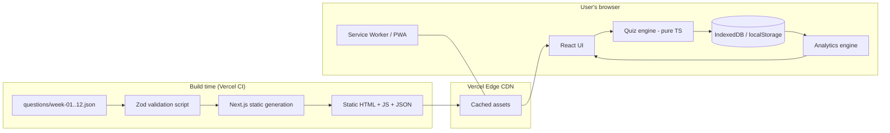

# NPTEL Quiz App: Architecture Document

> A zero-backend, zero-database, statically generated quiz platform for practicing 12 weeks of NPTEL questions, deployed free on Vercel.

---

## 1. Goals and Non-Goals

### Goals
- Practice, learn, and test modes across all 12 weeks of question data.
- Weekly quizzes and a cumulative "overall" quiz (the final exam simulation).
- Rich score analysis: per-week accuracy, weak topics, time per question, trends.
- Fast on any device, installable, works offline after first load.
- Free to host, effectively unlimited scale, near-zero maintenance.

### Non-Goals (v1)
- User accounts, login, or authentication.
- Server-side persistence of user data.
- Leaderboards or social features.
- Admin panel for editing questions (the JSON files in Git are the CMS).

### Guiding Principle
**No database until a feature truly requires shared or cross-device state.** Question data is read-only and static; user progress is private to one learner and fits comfortably in the browser.

---

## 2. Key Decision: Why No Database

| Need | Needs a DB? | Solution |
|---|---|---|
| Serve questions | No | Static JSON bundled at build time |
| Remember progress, attempts, scores | No | Browser storage (IndexedDB / localStorage) |
| Analytics on own performance | No | Computed client-side from stored attempts |
| Move progress to another device | No | Export / import progress file (JSON) |
| Backup | No | Same export / import |
| Global leaderboard, cohort stats | **Yes** | Deferred, see Section 14 |
| Login / sync across devices | **Yes** | Deferred, see Section 14 |

Result: the app is a pure static site. Vercel serves it from its global CDN, so traffic spikes cost nothing and nothing can overload a server because there is no server.

---

## 3. High-Level Architecture



**Flow:** JSON validated at build, baked into static output, served from CDN, executed entirely in the browser. User state never leaves the device.

---

## 4. Tech Stack

| Layer | Choice | Reason |
|---|---|---|
| Framework | **Next.js (App Router) + TypeScript** | First-class Vercel support, static export, great DX |
| Rendering | **Static generation (SSG)** | Pre-built pages, CDN-served, no compute cost |
| Styling | **Tailwind CSS + shadcn/ui** | Fast, accessible, consistent components |
| State | **Zustand** (+ `persist` middleware) | Tiny, simple, easy to persist |
| Storage | **IndexedDB via `idb-keyval` or Dexie** (fallback: localStorage) | Larger quota, structured data, async |
| Validation | **Zod** | Schema validation of question JSON at build and import |
| Charts | **Recharts** | Radar, line, bar charts for analysis |
| Animations | **Framer Motion** (sparingly) | Polished transitions |
| PWA | **Serwist** (or `next-pwa`) | Offline use, installable |
| Testing | **Vitest** (unit), **Playwright** (E2E) | Engine correctness and critical flows |
| Quality | ESLint, Prettier, TypeScript strict, Husky | Consistency |
| Hosting | **Vercel Hobby (free)** | CDN, preview deploys per PR |

---

## 5. Question Data Contract

You already have per-week JSON. Standardize it to this schema (adapt field names to your files; a small normalizer script can map them).

### 5.1 Schema

```json
{
  "week": 1,
  "title": "Introduction to ...",
  "questions": [
    {
      "id": "w01-q001",
      "question": "Which of the following ...?",
      "options": ["Option A", "Option B", "Option C", "Option D"],
      "answer": [1],
      "explanation": "Optional. Why B is correct.",
      "topic": "Optional tag, e.g. 'Regression'",
      "difficulty": "easy | medium | hard (optional)"
    }
  ]
}
```

### 5.2 Rules
- **Stable IDs** (`wXX-qYYY`). Progress is keyed by ID, so never renumber or reuse IDs after release.
- `answer` is an **array of option indexes**, which supports both single-correct and multi-select (MSQ) questions.
- `explanation`, `topic`, `difficulty` are optional but unlock the "learn" mode and weak-topic analysis. Adding `topic` is the highest-value enrichment you can do.
- Images or code in questions: use Markdown in `question`/`options` and store images under `/public/img/`.

### 5.3 Build-time validation
A `scripts/validate-questions.ts` step runs before `next build` and fails the deploy if any of these hold:
- Duplicate IDs
- `answer` index out of range
- Fewer than 2 options
- Empty question text
- Week number mismatch with filename

A bad JSON edit can therefore never reach production.

---

## 6. Application Modes

| Mode | Purpose | Behavior |
|---|---|---|
| **Learn** | Study with feedback | One question at a time, instant correct/incorrect, explanation shown, no scoring pressure |
| **Practice** | Drill weak areas | Filter by week, topic, difficulty, "previously wrong", "bookmarked"; instant feedback |
| **Weekly Quiz** | Simulate a weekly assignment | Pick a week, fixed set, answers revealed only at the end, optional timer |
| **Overall Quiz** | Simulate the final exam | Questions sampled from all 12 weeks (configurable count, even or weighted distribution), timer, results at the end |
| **Review Mistakes** | Fix gaps | Auto-built from questions answered wrong, ordered by recency / frequency |
| **Revision (spaced repetition)** | Long-term retention | Leitner-box scheduling: wrong answers return sooner, mastered ones fade out |

### Quiz Configuration (all configurable, none hardcoded)
- Question count, time limit, shuffle questions, shuffle options
- Negative marking toggle (NPTEL-style rules vary, so keep it a setting)
- Mark/bookmark for review, skip and come back, navigator panel

---

## 7. Core Engine (Pure TypeScript, UI-Agnostic)

The quiz logic lives in `src/lib/engine/` as pure functions with no React imports. This makes it trivially unit-testable and reusable.

```
buildQuiz(config, questionBank, history) -> QuizSession
answerQuestion(session, qid, selected)   -> QuizSession
scoreSession(session, scoringRules)      -> Result
nextRevisionBatch(history, now)          -> Question[]
```

### Key behaviors
- **Seeded shuffle** (e.g. mulberry32 seeded by session ID): the same session reproduces the same order after refresh or resume.
- **Answer remapping**: when options are shuffled, store the original index so analytics stay consistent.
- **Autosave**: the session state is persisted after every answer, so an accidental tab close never loses a quiz.
- **Overall quiz sampling strategies**: `even` (equal per week), `proportional` (by question count), `weak-weighted` (more from low-accuracy weeks).

---

## 8. Client-Side Data Model

All stored locally. One versioned namespace, e.g. `nptelquiz:v1`.

```ts
interface Attempt {
  id: string;               // uuid
  type: 'weekly' | 'overall' | 'practice' | 'learn' | 'revision';
  week?: number;
  startedAt: number;
  finishedAt?: number;
  config: QuizConfig;
  answers: {
    qid: string;
    selected: number[];     // original option indexes
    correct: boolean;
    timeMs: number;
    flagged?: boolean;
  }[];
  score?: number;
  maxScore?: number;
}

interface QuestionStats {   // per question, drives spaced repetition
  qid: string;
  seen: number;
  correct: number;
  lastSeen: number;
  box: 1 | 2 | 3 | 4 | 5;   // Leitner box
  bookmarked: boolean;
}

interface Settings {
  theme: 'light' | 'dark' | 'system';
  defaultTimerMin?: number;
  negativeMarking: boolean;
  shuffleOptions: boolean;
}
```

### Storage strategy
- **IndexedDB** for `attempts` and `questionStats` (can grow large).
- **localStorage** for tiny settings only.
- **Schema versioning + migrations**: every stored blob carries `version`; a migration function upgrades old data when the schema changes.
- **Export / Import**: one-click download of everything as `nptel-progress.json`, plus a validated import. This is the cross-device story without a backend.
- Request `navigator.storage.persist()` so the browser is less likely to evict data.
- Show a gentle note: *"Progress is stored on this device. Export to back it up."*

---

## 9. Score Analysis (The "Top Tier" Part)

All computed client-side from `attempts` and `questionStats`.

### Dashboard
- **Overall readiness score**: a weighted blend of accuracy, recency, and coverage.
- **Coverage**: how many of the total questions you've seen, shown per week.
- **Streak and activity heatmap** (GitHub-style calendar).

### Per-Attempt Result Screen
- Score, percentage, time taken, average time per question
- Correct / incorrect / skipped breakdown
- Full answer review with your answer vs correct answer and explanation
- Comparison against your previous attempt of the same type

### Trends and Insights
- **Week-wise accuracy bar chart** with a clear weakest-week highlight
- **Topic radar chart** (requires `topic` tags)
- **Score trend line** across attempts over time
- **Time analysis**: slowest questions, rushed-and-wrong questions
- **Weak spots list** with a one-click "Practice these" action
- **Confidence signals**: questions you got right but slowly, or flipped between right and wrong

---

## 10. Routes and Pages

```
/                       Landing / dashboard summary
/learn                  Choose week -> learn mode
/practice               Filters -> practice mode
/quiz/weekly/[week]     Weekly quiz setup + runner
/quiz/overall           Overall quiz setup + runner
/revision               Spaced-repetition session
/review/[attemptId]     Detailed result review
/analytics              Full analysis dashboard
/bookmarks              Saved questions
/settings               Theme, rules, export/import, reset
```

Because attempt data lives in the browser, pages like `/review/[attemptId]` render client-side after reading IndexedDB. Static shells with client data hydration keep everything on the free CDN path.

---

## 11. Project Structure

```
nptel-quiz/
├─ data/
│  └─ questions/
│     ├─ week-01.json  ...  week-12.json
├─ scripts/
│  ├─ validate-questions.ts     # Zod validation, runs on prebuild
│  └─ build-index.ts            # generates compact manifest (counts, topics)
├─ src/
│  ├─ app/                      # Next.js routes
│  ├─ components/
│  │  ├─ quiz/                  # QuestionCard, Navigator, Timer, ResultSummary
│  │  ├─ charts/                # Radar, WeekBar, TrendLine, Heatmap
│  │  └─ ui/                    # shadcn components
│  ├─ lib/
│  │  ├─ engine/                # pure quiz logic (unit tested)
│  │  ├─ storage/               # IndexedDB wrappers, migrations, export/import
│  │  ├─ analytics/             # aggregation and insight functions
│  │  └─ schema/                # Zod schemas and shared types
│  ├─ store/                    # Zustand stores
│  └─ styles/
├─ public/                      # icons, manifest, question images
├─ tests/                       # Vitest + Playwright
├─ ARCHITECTURE.md
└─ package.json
```

---

## 12. Performance and Scalability

### Why this scales to any traffic
- Every page is **pre-rendered static HTML**; every request is a CDN cache hit.
- There is **no server compute, no DB connection pool, no cold start** in the request path.
- Per-user state lives on the user's device, so user growth adds zero backend load.

### Loading strategy (12 weeks of JSON)
- Estimated question data is small (hundreds to a few thousand questions), but don't ship it all upfront:
  - Keep one **manifest** (week titles, counts, topics) in the main bundle.
  - Load **per-week JSON on demand** (`/data/week-05.json`) via dynamic import or static file fetch.
  - The overall quiz loads all weeks once, then they are cached by the service worker.
- Immutable asset caching with hashed filenames; the service worker precaches the shell and question files for offline use.

### Targets
- Lighthouse 95+ on Performance, Accessibility, Best Practices, SEO
- LCP under 1.5s on mid-range mobile, JS per route kept lean
- Lazy-load charts (analytics route only) so quiz screens stay light

### Vercel free-tier fit
Static hosting uses bandwidth only. Keep an eye on the Hobby plan's bandwidth and build limits. If you ever outgrow them, the same static output deploys unchanged to Cloudflare Pages or Netlify as an escape hatch. Note that Vercel's Hobby tier is for non-commercial use.

---

## 13. UX, Accessibility, and Quality

- **Mobile-first**; most learners practice on phones.
- **Keyboard shortcuts**: `1-4` select option, `Enter` submit/next, `F` flag, `←/→` navigate.
- **Dark mode** and a distraction-free quiz layout.
- **WCAG AA**: proper roles and labels, visible focus, color never the only signal, respects `prefers-reduced-motion`.
- **Resume**: reopening the app offers "Resume your unfinished quiz".
- **Timer integrity**: based on timestamps rather than ticking counters, so it stays correct across tab switches and sleep.
- **Error handling**: graceful fallback if IndexedDB is blocked (private mode), switching to in-memory mode with a visible warning.

### Testing
| Level | Tool | Covers |
|---|---|---|
| Unit | Vitest | Engine, scoring, shuffling, analytics math, migrations |
| Data | Zod script | Question JSON integrity on every build |
| E2E | Playwright | Take a weekly quiz, take overall quiz, export / import, resume |
| Visual / a11y | axe + Lighthouse CI | Accessibility and performance regression gates |

---

## 14. When (and How) to Add a Database Later

Add a backend only when one of these becomes a real requirement:

| Feature | Minimal addition |
|---|---|
| Cross-device sync | Auth (Clerk / Auth.js) + Postgres (Neon / Supabase free tier) |
| Global leaderboard | Vercel KV / Upstash Redis (sorted sets) + a rate-limited API route |
| Anonymous cohort stats ("you beat 70%") | Aggregate-only counters in Redis, no personal data |
| Community-contributed questions | Git-based PR flow first, DB only if volume demands it |

### How the design keeps this cheap
- The `storage/` layer sits behind an interface (`ProgressRepository`). v1 implements it with IndexedDB; a future `RemoteRepository` can implement the same interface and sync in the background.
- Stable question IDs and versioned data models mean existing local progress can be uploaded on first login without transformation.

---

## 15. Deployment and CI/CD

1. Push the repo to GitHub and import it into Vercel.
2. `prebuild` runs `validate-questions` and builds the manifest. A failure blocks the deploy.
3. Every PR gets an automatic **preview URL**; merging to `main` deploys to production.
4. GitHub Actions run type-check, lint, unit tests, and Playwright on PRs.
5. Optional: Vercel Web Analytics (privacy-friendly) for traffic, with no tracking of quiz content.

### Updating questions
Edit a JSON file, open a PR, validation passes, merge, live in about a minute. Never change existing IDs; append new ones.

---

## 16. Security and Privacy

- No accounts, no PII, no cookies needed, so GDPR exposure is minimal.
- All user data stays on-device; the privacy page can say so plainly.
- Import is validated with Zod and size-limited to reject malformed or malicious files.
- Standard security headers via `next.config.js` (CSP, `X-Content-Type-Options`, `Referrer-Policy`).
- The answer key ships to the client (unavoidable in a static app). This is acceptable for a practice tool; it is **not** suitable for proctored or high-stakes assessment.

---

## 17. Phased Roadmap

| Phase | Scope | Outcome |
|---|---|---|
| **0. Data prep** | Normalize the 12 JSON files to the schema, add Zod validation, add `topic` tags where possible | Clean, trusted question bank |
| **1. MVP** | Week picker, Learn + Practice modes, weekly quiz, results screen, local storage | Usable end to end |
| **2. Exam mode** | Overall quiz, timer, negative marking, navigator, resume, bookmarks | Realistic exam simulation |
| **3. Analytics** | Dashboard, week bars, topic radar, trends, weak-spot practice | Score analysis |
| **4. Retention** | Spaced repetition, review mistakes, streaks and heatmap | Long-term learning |
| **5. Polish** | PWA/offline, keyboard shortcuts, dark mode, a11y audit, Lighthouse tuning, export / import | Top-tier finish |
| **6. (Optional)** | Sync, leaderboard via the DB path in Section 14 | Only if needed |

---

## 18. Risks and Mitigations

| Risk | Mitigation |
|---|---|
| Browser data cleared, progress lost | Persist request, export / import, periodic "back up" nudge |
| Bad question data (wrong answer index) | Build-time validation, plus an in-app "Report issue" link prefilled to a GitHub issue |
| IndexedDB unavailable | In-memory fallback with a visible warning |
| Question set changes mid-semester | Stable IDs plus a `dataVersion` so stats for removed questions are archived, not crashed on |
| Free-tier limits | Static output is portable to other free hosts |

---

## 19. Open Questions (Need Your Input)

1. Can you share one sample of your current JSON? I will map it exactly to the schema in Section 5.
2. Do any questions have **multiple correct answers**, images, or code snippets?
3. Do you have **topic tags** or explanations, or should we add them (even a rough topic per question greatly improves analytics)?
4. Rough **question count per week**, so we can set sensible defaults for quiz sizes?
5. Should the overall quiz mimic NPTEL's real exam format (question count, duration, marking scheme)?

---

*Version 1.0. A static-first, database-optional architecture designed to scale without cost.*