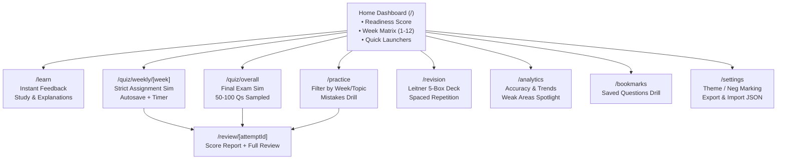

# Design Engineering & UI/UX Specification: NPTEL Quiz App

> **Design Bible & Interaction Contract**  
> Synthesizing **Emil Kowalski's Design Engineering**, **Leonxlnx/taste-skill (Anti-Slop Craft)**, **Apple Human Interface fluid motion**, and **Mobile-Native Execution**.  
> Target: **Achromatic, data-first, award-grade learning & exam platform** running statically on desktop and mobile web.

---

## 1. Aesthetic Vision & The Anti-Slop Discipline

### 1.1 The Anti-Template Philosophy
Most generated apps look like the generic average of a template: a saturated sidebar, an icon inside a tinted circle on every KPI card, soft purple gradients, and floating glass cards.
**This app eliminates all template slop.**
- **Color goes on DATA, not on chrome.** Less than 1% colored pixels in the interface chrome.
- **KPIs are clean typography, never icon tiles.** No icons in tinted circles on stats, no artificial sparklines. Numbers are set in tabular figures (`font-variant-numeric: tabular-nums`) with quiet, crisp labels.
- **Flat, quiet surfaces:** Separation is achieved through hairlines (1px `#e6e6e6` / `rgba(255,255,255,0.08)`) or one subtle tone step—not heavy blurry drop-shadows.
- **Ground from the Product’s World:** A subtle, low-chroma Sage ground (`#f2f5f2` in light mode, `#0c0e0c` obsidian in dark mode) reflecting conservation economics, ecology, and forestry. Cards sit crisp white/dark-surface against this organic tint.
- **One Main Data Hue:** A single focused forest teal (`#0f766e` / `#2dd4bf`) marks the primary data element (accuracy bars, active quiz progress, current week). Correct answers are emerald (`#10b981`), mistakes are soft red (`#ef4444`), flags are amber (`#f59e0b`).

---

## 2. Color System & Semantic Tokens (Achromatic Ledger + Sage Ground)

```css
:root {
  /* Surface Layers (Light Mode) */
  --ground: #f4f6f4;           /* Low-chroma sage tint from conservation world */
  --surface: #ffffff;          /* Pure white card surface */
  --raised: #ecefec;           /* Slightly raised interactive states */
  --border: #e2e6e2;           /* Subtle 1px boundary */
  --rule: #ebebeb;             /* Internal dividers */
  
  /* Text & Ink */
  --text-ink: #0a0a0a;         /* High-contrast ink */
  --text-muted: #5a625a;       /* Quiet secondary text */
  --text-tertiary: #8c948c;    /* Faint metadata/keys */

  /* The One Data Hue (Forest Accent) */
  --data-hue: #0f766e;         /* Teal-700 / Forest */
  --data-hue-subtle: #f0fdfa;  /* Very pale data tint */
  --data-hue-ink: #134e4a;
  
  /* Status Signals (Only for state changes & accuracy) */
  --status-correct: #15803d;   /* Green-700 */
  --status-correct-bg: #f0fdf4;
  --status-wrong: #b91c1c;     /* Red-700 */
  --status-wrong-bg: #fef2f2;
  --status-flag: #b45309;      /* Amber-700 */
  --status-flag-bg: #fffbeb;

  /* Typography Scale */
  --radius-card: 8px;
  --radius-control: 6px;
  --radius-badge: 4px;
}

.dark {
  /* Surface Layers (Dark Mode - Obsidian Slate) */
  --ground: #0a0c0a;           /* Deep obsidian-sage */
  --surface: #121512;          /* Clean dark card */
  --raised: #1a1e1a;           /* Secondary surface */
  --border: rgba(255, 255, 255, 0.08);
  --rule: rgba(255, 255, 255, 0.05);

  /* Text & Ink */
  --text-ink: #f5f7f5;
  --text-muted: #9ba39b;
  --text-tertiary: #606860;

  /* Data Hue */
  --data-hue: #2dd4bf;         /* Teal-400 */
  --data-hue-subtle: rgba(45, 212, 191, 0.12);
  --data-hue-ink: #99f6e4;

  /* Status Signals */
  --status-correct: #4ade80;
  --status-correct-bg: rgba(74, 222, 128, 0.12);
  --status-wrong: #f87171;
  --status-wrong-bg: rgba(248, 113, 113, 0.12);
  --status-flag: #fbbf24;
  --status-flag-bg: rgba(251, 191, 36, 0.12);
}
```

---

## 3. Typography & Numerical Precision

Fonts: **Geist** (editorial clarity, sentence-case) + **Geist Mono** (IDs, timers, option keys, and scores).

| Role | Font | Size | Weight | Tracking | Usage |
|---|---|---|---|---|---|
| **KPI Value** | Geist Mono | 30px | 600 SemiBold | `tabular-nums` | `10/10`, `94%`, `04:12` |
| **KPI Label** | Geist | 12px | 500 Medium | `+0.01em` | "OVERALL READINESS", "TIME/Q" |
| **Page Title** | Geist | 22px | 600 SemiBold | `-0.02em` | Section heads, week titles |
| **Question Body** | Geist | 16px | 400 Regular | `-0.01em` | Question prompt |
| **Option Text** | Geist | 15px | 400 Regular | `0em` | Option choices A, B, C, D |
| **Option Key Badge** | Geist Mono | 12px | 500 Medium | `tabular-nums` | `[1]`, `[2]`, `[3]`, `[4]` |
| **Explanation Text** | Geist | 14px | 400 Regular | `0em` | Post-answer learning explanation |

**Strict Anti-Slop Rule:** Always apply `font-variant-numeric: tabular-nums` to every count, timer, question index, and percentage so numbers do not wiggle or shift layout when values increment.

---

## 4. The Emil Kowalski Motion Framework

Motion is used strictly to communicate **spatial consistency** and **tactile feedback**; never as decoration.

### 4.1 Custom Easing Curves & Durations
```css
:root {
  /* The Signature Emil Ease-Out: Starts explosive, glides to a stop */
  --ease-out: cubic-bezier(0.23, 1, 0.32, 1);
  
  /* Smooth ease-in-out for morphing containers */
  --ease-in-out: cubic-bezier(0.77, 0, 0.175, 1);
  
  /* Tactile iOS-grade drawer curve */
  --ease-drawer: cubic-bezier(0.32, 0.72, 0, 1);

  /* Precise durations */
  --duration-press: 100ms;
  --duration-snap: 160ms;
  --duration-modal: 220ms;
  --duration-drawer: 280ms;
}
```

### 4.2 Interactive Physics Rules

| Component | Trigger | Animation Spec | Purpose |
|---|---|---|---|
| **Buttons & Clickables** | `:active` / `pointerdown` | `transform: scale(0.97)` over 100ms `--ease-out` | Instant confirmation that the UI heard the user |
| **Option Tile Selection** | Selection | `transform: scale(0.99)` + border morph + subtle fill tint | Tactile option lock-in |
| **Question Transition** | Next / Prev | Slide `X` (±16px) + Opacity (0 -> 1) over 180ms `--ease-out` | Spatial continuity without motion fatigue |
| **Modals & Dialogs** | Open / Close | Enter from `scale(0.95)` + `opacity: 0` to `scale(1)` in 200ms | Never scale from 0. Center-origin |
| **Navigator Drawer (Mobile)** | Open / Close | `translateY(100%)` to `0` using `--ease-drawer` (280ms) with momentum flick support | Natural thumb physics |
| **Instant Learn Feedback** | Answer reveal | Green/Red glow bloom (`0 0 12px var(--status-*-bg)`) + subtle blur crossfade | No jarring flash; smooth state morph |
| **Keyboard Shortcuts** | Keypress (`1-4`, `F`) | **0ms animation**. Instant state toggle. | Raycast rule: high-frequency keyboard actions must never animate |

---

## 5. Mobile-Native Polish Contract

90% of exam practice happens on phones. The app must feel like a native iOS/Android client, not an embedded web page.

### 5.1 CSS & Viewport Foundations
```css
/* 1. Eliminate Tap Highlights & Janky Delays */
html {
  -webkit-tap-highlight-color: transparent;
  -webkit-text-size-adjust: 100%;
  overscroll-behavior: none; /* Prevents whole-page rubber-band pull */
}

/* 2. Responsive True App Shell Height */
.app-container {
  min-height: 100dvh; /* Dynamic viewport height reacting to keyboard & address bar */
}

/* 3. Never Zoom On Inputs */
input, select, textarea {
  font-size: 16px !important; /* Prevents iOS auto-zoom cropping */
}

/* 4. Tappable Hit-Areas & Instant Manipulation */
button, a, [role="button"], .interactive-tile {
  touch-action: manipulation; /* Eliminates 300ms click delay */
  user-select: none;
  -webkit-user-select: none;
  min-height: 44px; /* Apple minimum touch target */
}

/* 5. Safe Area Insets for Edge-to-Edge Displays */
.header-safe {
  padding-top: max(env(safe-area-inset-top), 12px);
}
.bottom-nav-safe {
  padding-bottom: max(env(safe-area-inset-bottom), 16px);
}

/* 6. Sticky Hover Prevention */
@media (hover: hover) and (pointer: fine) {
  .hover-card:hover {
    transform: translateY(-2px);
    box-shadow: var(--shadow-md);
  }
}
```

---

## 6. Component Architecture & UI Anatomy

### 6.1 The Question Card (`src/components/quiz/QuestionCard.tsx`)
The centerpiece of the entire learning experience.

```
┌────────────────────────────────────────────────────────────────────────┐
│  QUESTION 04 OF 10                       [★ Flag (F)]  [1 Point]       │
│                                                                        │
│  A lake still exists physically, but sewage and plastic waste reduce   │
│  the number of fish it can support. This is best called:               │
│                                                                        │
│  ┌──────────────────────────────────────────────────────────────────┐  │
│  │ [1]  Habitat degradation                                  (✓)    │  │
│  └──────────────────────────────────────────────────────────────────┘  │
│  ┌──────────────────────────────────────────────────────────────────┐  │
│  │ [2]  Habitat fragmentation                                       │  │
│  └──────────────────────────────────────────────────────────────────┘  │
│  ┌──────────────────────────────────────────────────────────────────┐  │
│  │ [3]  Jump dispersal                                              │  │
│  └──────────────────────────────────────────────────────────────────┘  │
│  ┌──────────────────────────────────────────────────────────────────┐  │
│  │ [4]  Secular dispersal                                           │  │
│  └──────────────────────────────────────────────────────────────────┘  │
│                                                                        │
│  💡 Explanation: (Expanded in Learn mode or Post-Quiz review)          │
│  Degradation affects ecosystem quality while physical space remains.   │
└────────────────────────────────────────────────────────────────────────┘
```

**Craft Details:**
- **Key Badge:** Monospace pill `[1]`, `[2]`, `[3]`, `[4]` on the left. Subtle neutral tone when unselected, data hue highlight when selected.
- **Card State:**
  - *Default:* Surface background, 1px hairline border (`var(--border)`). No shadow.
  - *Hover (desktop pointer fine only):* Border shifts to `--text-muted`.
  - *Active (press):* Scales to `0.985`, background shifts subtly.
  - *Selected:* 1.5px accent border (`var(--data-hue)`), background `var(--data-hue-subtle)`.
  - *Correct / Wrong (Learn & Review modes):* Calm background tint (`var(--status-correct-bg)` / `var(--status-wrong-bg)`), clean check/cross marker, zero abrasive red flashes.

### 6.2 The Quiz Navigator (Desktop Side Panel / Mobile Bottom Sheet)
- **Desktop:** Sticky right-hand rail displaying a clean 5-column grid of number chips (1–10 or 1–100).
  - Status indicators:
    - *Unanswered:* Faint hairline border with muted text.
    - *Answered:* Filled surface with ink text and a 2px bottom dot in data hue.
    - *Flagged:* Small amber marker.
    - *Current Question:* Accent ring around the chip.
- **Mobile:** Accessible bottom sheet (built using Vaul) with velocity drag-to-dismiss (`touch-action: pan-x`).

### 6.3 Resilient Timestamp-Based Timer (`src/components/quiz/QuizTimer.tsx`)
- Displays `MM:SS` in `Geist Mono` with tabular numbers (`font-variant-numeric: tabular-nums`).
- Calculated from `targetEndTime - Date.now()`. No ticking interval desync when user switches apps or device sleeps.
- Urgency: under 2 minutes shifts subtly to `--status-flag` amber, never abrasive red.

### 6.4 The Score & Readiness Dashboard (`src/app/page.tsx` & `/analytics`)
- **Readiness Metric (Achromatic KPI):**
  - Label: `READINESS SCORE` (12px, muted, uppercase).
  - Value: `88%` (32px Geist Mono, ink).
  - Subline: "Calculated across 12 weeks: accuracy (50%), coverage (30%), recency (20%)."
- **Week Progress Matrix:** 12 clean rows/cards representing Weeks 1–12 with title, question count, best attempt, and one-click action.
- **Week Accuracy Bar Chart:**
  - Clean hairline axes, single series in `--data-hue`, with weakest week subtly highlighted.
  - No rainbow gradients, no 3D bevels.

---

## 7. Accessibility & Keyboard Shortcuts (WCAG AA Compliance)

Every action in the entire application can be operated exclusively via keyboard:

| Key | Context | Action |
|---|---|---|
| `1`, `2`, `3`, `4` | Quiz Runner | Select Option A, B, C, D |
| `Enter` | Quiz Runner | Confirm / Next Question |
| `Backspace` / `Left Arrow` | Quiz Runner | Previous Question |
| `F` | Quiz Runner | Flag / Unflag Question |
| `N` / `M` | Quiz Runner | Open / Close Question Navigator |
| `Space` | Learn / Revision | Reveal Answer / Flip Card |
| `Escape` | Modals / Drawers | Dismiss Modal or Drawer |
| `?` | Global | Open Keyboard Shortcuts Cheat Sheet |

- **Focus Rings:** High-visibility 2px focus ring (`ring-2 ring-teal-600 ring-offset-2`) only on keyboard tab navigation (`:focus-visible`), never on mouse clicks.
- **Screen Reader Announcements:** ARIA live regions for timer countdown under 2 mins, correct/wrong reveals, and question changes.

---

## 8. Emil Kowalski & Anti-Slop Review Checklist

Before any UI pull request or commit is merged, verify against this table:

| Check | Requirement |
|---|---|
| **Property Transitions** | No `transition: all`. Explicitly name `transform`, `opacity`, `background-color`. |
| **Animation Start** | Never scale from `scale(0)`. Start from `scale(0.95)` with `opacity: 0`. |
| **Duration Limit** | UI animations must be between 100ms and 280ms. |
| **Keyboard Actions** | 0ms animation on keyboard selections (`1-4`, `F`). |
| **Touch Delay** | `touch-action: manipulation` applied to every button. |
| **Active States** | Every button and interactive card has an active state (`scale(0.97)`). |
| **Viewport Boundaries** | Uses `100dvh` for app shells, `env(safe-area-inset-*)` with `viewport-fit=cover`. |
| **Text Selectability** | Controls have `user-select: none`. Question and reading text remain selectable. |
| **Anti-Slop Color** | Color on DATA, not on chrome. Less than 1% colored pixels in the frame. |
| **No Tinted Circles** | No icons in colored circles on KPI numbers. Figures are clean tabular type. |
| **Tabular Numbers** | `tabular-nums` applied to timers, scores, question indices, percentages. |


---

## 7. Application Screens & Flow States



### 7.1 Screen Specifics

#### Screen 1: Dashboard (`/`)
- **Top Bar:** Brand logo with Conservation leaf glyph, active streak counter (`🔥 4 Days`), theme toggle, settings icon.
- **Hero:** Quick Start Card ("Continue Week 3" or "Daily 10-Question Revision").
- **Grid:** 12-week interactive cards with progress radial indicators.

#### Screen 2: Quiz Runner (`/quiz/weekly/[week]` & `/quiz/overall`)
- **Minimalist Header:** Clean, non-distracting. Only contains:
  - Exit button (with "Save & Pause" modal).
  - Progress bar (thinned 3px line at top of viewport).
  - Question number pill (`Q 04/10`).
  - Timer pill.
  - Navigator toggle button.
- **Card Viewport:** Vertically centered on desktop, comfortably top-padded on mobile.
- **Bottom Action Bar:**
  - Back (`←` or `Prev`)
  - Flag for Review (`F`)
  - Clear Selection
  - Next / Submit (`Enter` or `Next →`)

#### Screen 3: Review & Mistakes Screen (`/review/[attemptId]`)
- **Hero Banner:** Confetti animation on score $\ge 80\%$, clear breakdown:
  - Score (`9/10`)
  - Accuracy (`90%`)
  - Time Spent (`04m 32s`)
  - Average per question (`27s`)
- **Filter Tabs:** `All (10)` | `Incorrect (1)` | `Flagged (2)` | `Bookmarked (3)`.
- **Question Review Tile:** Displays learner's answer vs correct answer with highlighted diff and markdown explanation.

#### Screen 4: Spaced Repetition (`/revision`)
- **Visual Deck:** 5 Leitner boxes illustrated with cards count (`Box 1: 8`, `Box 2: 14`, `Box 3: 25`, `Box 4: 40`, `Box 5: 33`).
- **Interactive Flashcard:** Tap/Space to reveal answer, buttons: "Need Practice" (demote to Box 1) vs "Mastered" (promote to Box +1).

#### Screen 5: Settings & Portability (`/settings`)
- **Exam Rules:** Toggle negative marking (-0.25), toggle option shuffling, set default exam timer (e.g. 30 min).
- **Data Portability Card:**
  - One-click "Download Backup" (`nptel-progress.json`).
  - "Import Progress" drag-and-drop zone with instant Zod schema validation.
  - "Reset All Data" with safety confirmation phrase modal.

---

## 8. Accessibility & Keyboard Shortcuts (WCAG AA Compliance)

Every action in the entire application can be operated exclusively via keyboard:

| Key | Context | Action |
|---|---|---|
| `1`, `2`, `3`, `4` | Quiz Runner | Select Option A, B, C, D |
| `Enter` | Quiz Runner | Confirm / Next Question |
| `Backspace` / `Left Arrow` | Quiz Runner | Previous Question |
| `F` | Quiz Runner | Flag / Unflag Question |
| `N` / `M` | Quiz Runner | Open / Close Question Navigator |
| `Space` | Learn / Revision | Reveal Answer / Flip Card |
| `Escape` | Modals / Drawers | Dismiss Modal or Drawer |
| `?` | Global | Open Keyboard Shortcuts Cheat Sheet |

- **Focus Rings:** High-visibility 2px focus ring (`ring-2 ring-emerald-500 ring-offset-2`) only on keyboard tab navigation (`:focus-visible`), never on mouse clicks.
- **Screen Reader Announcements:** ARIA live regions for timer countdown under 2 mins, correct/wrong reveals, and question changes.

---

## 9. Performance & Core Web Vitals Targets

- **First Contentful Paint (FCP):** $< 0.8\text{s}$
- **Largest Contentful Paint (LCP):** $< 1.2\text{s}$
- **Cumulative Layout Shift (CLS):** `0.00` (strict dimensions on cards, zero unsized images)
- **Interaction to Next Paint (INP):** $< 50\text{ms}$ (instant CSS transitions off main-thread)
- **Bundle Footprint:** Recharts and heavy SVG utilities dynamically imported only on `/analytics`.
- **Zero CLS Skeleton Loaders:** All dynamic stats use exact-height skeleton placeholders.

---

## 10. Design Review Checklist (Emil Kowalski Gate)

Before any UI pull request or commit is merged, verify against this table:

| Check | Requirement |
|---|---|
| **Property Transitions** | No `transition: all`. Explicitly name `transform`, `opacity`, `background-color`. |
| **Animation Start** | Never scale from `scale(0)`. Start from `scale(0.95)` with `opacity: 0`. |
| **Duration Limit** | UI animations must be between 100ms and 280ms. |
| **Touch Delay** | `touch-action: manipulation` applied to every button. |
| **Active States** | Every button and interactive card has an active state (`scale(0.97)`). |
| **Viewport Boundaries** | Uses `100dvh` for app shells, `env(safe-area-inset-*)` with `viewport-fit=cover`. |
| **Text Selectability** | Controls have `user-select: none`. Question and reading text remain selectable. |
| **Dark Mode Contrast** | Backgrounds use true zinc/obsidian layers; text meets 4.5:1 minimum contrast. |
