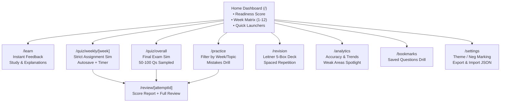

# Design Engineering & UI/UX Specification: NPTEL Quiz App

> **Design Bible & Interaction Contract**  
> Built with Emil Kowalski's Design Engineering principles, Apple Human Interface fluid motion, and mobile-native execution.  
> Target: **World-class, premium SaaS-grade learning & exam platform** running statically on desktop and mobile web.

---

## 1. Aesthetic Vision & Personality

### The Philosophy: "Calm Focus & Spatial Directness"
- **Inspiration:** *Linear's* density & keyboard speed + *Apple's* tactile physics & materials + *Duolingo's* clarity without the cartoonish clutter.
- **The Mood:** Quiet confidence. The UI gets out of the way so learners enter a flow state. No flashing banners, no cheesy gamification, no unnecessary decorative noise.
- **Micro-Delight:** Every keystroke, button press, option toggle, and tab transition has immediate tactile feedback (`:active` compression, origin-aware popovers, crisp physics, subtle audio/haptic cues on touch).

---

## 2. Color System & Semantic Tokens

Both Light Mode (Crisp Porcelain) and Dark Mode (Obsidian Matte) are tuned for high contrast, strict WCAG AA/AAA compliance, and zero eye fatigue during multi-hour exam simulations.

### 2.1 Palette Tokens

```css
:root {
  /* Surface Layers (Light) */
  --bg-canvas: #f8fafc;        /* slate-50 */
  --bg-surface: #ffffff;       /* pure white */
  --bg-subtle: #f1f5f9;        /* slate-100 */
  --bg-muted: #e2e8f0;         /* slate-200 */
  
  /* Text & Content */
  --text-primary: #0f172a;     /* slate-900 */
  --text-secondary: #475569;   /* slate-600 */
  --text-tertiary: #94a3b8;    /* slate-400 */
  
  /* Borders & Dividers */
  --border-subtle: rgba(15, 23, 42, 0.08);
  --border-medium: rgba(15, 23, 42, 0.14);
  --border-strong: rgba(15, 23, 42, 0.22);
  
  /* Brand / Conservation Forest Accent */
  --brand-primary: #059669;    /* emerald-600 */
  --brand-primary-hover: #047857;
  --brand-subtle: #ecfdf5;     /* emerald-50 */
  --brand-ring: rgba(5, 150, 105, 0.25);

  /* Status Colors */
  --status-correct: #10b981;   /* emerald-500 */
  --status-correct-bg: #ecfdf5;
  --status-wrong: #ef4444;     /* red-500 */
  --status-wrong-bg: #fef2f2;
  --status-flag: #f59e0b;      /* amber-500 */
  --status-flag-bg: #fffbeb;
  --status-info: #0284c7;      /* sky-600 */
  
  /* Shadows & Elevations */
  --shadow-sm: 0 1px 2px 0 rgba(0, 0, 0, 0.04);
  --shadow-md: 0 4px 6px -1px rgba(0, 0, 0, 0.07), 0 2px 4px -2px rgba(0, 0, 0, 0.05);
  --shadow-lg: 0 12px 24px -4px rgba(0, 0, 0, 0.08), 0 4px 8px -2px rgba(0, 0, 0, 0.04);
}

.dark {
  /* Surface Layers (Dark - Obsidian) */
  --bg-canvas: #09090b;        /* zinc-950 */
  --bg-surface: #121215;       /* deep obsidian card */
  --bg-subtle: #18181b;        /* zinc-900 */
  --bg-muted: #27272a;         /* zinc-800 */
  
  /* Text & Content */
  --text-primary: #f4f4f5;     /* zinc-100 */
  --text-secondary: #a1a1aa;   /* zinc-400 */
  --text-tertiary: #71717a;    /* zinc-500 */
  
  /* Borders & Dividers */
  --border-subtle: rgba(255, 255, 255, 0.08);
  --border-medium: rgba(255, 255, 255, 0.14);
  --border-strong: rgba(255, 255, 255, 0.25);
  
  /* Brand Accent */
  --brand-primary: #10b981;    /* emerald-500 */
  --brand-primary-hover: #34d399;
  --brand-subtle: rgba(16, 185, 129, 0.12);
  --brand-ring: rgba(16, 185, 129, 0.35);

  /* Status Colors (Adjusted for dark readability) */
  --status-correct: #34d399;
  --status-correct-bg: rgba(52, 211, 153, 0.12);
  --status-wrong: #f87171;
  --status-wrong-bg: rgba(248, 113, 113, 0.12);
  --status-flag: #fbbf24;
  --status-flag-bg: rgba(251, 191, 36, 0.12);
  --status-info: #38bdf8;

  /* Shadows (Tuned for dark depth with subtle luminous border highlights) */
  --shadow-sm: 0 1px 2px 0 rgba(0, 0, 0, 0.5);
  --shadow-md: 0 4px 12px -2px rgba(0, 0, 0, 0.6);
  --shadow-lg: 0 16px 32px -4px rgba(0, 0, 0, 0.7);
}
```

---

## 3. Typography & Hierarchy

Font Stack: **Geist Sans** (or Inter) + **Geist Mono** (for timers, question numbers, scores).

| Token | Size | Line Height | Weight | Letter Spacing | Usage |
|---|---|---|---|---|---|
| `display-1` | 32px / 2rem | 1.15 | 700 SemiBold | `-0.03em` | Hero score numbers, readiness banner |
| `h1` | 24px / 1.5rem | 1.25 | 600 SemiBold | `-0.025em` | Page titles, quiz mode header |
| `h2` | 18px / 1.125rem | 1.35 | 600 SemiBold | `-0.015em` | Question prompt, section heads |
| `body-lg` | 16px / 1rem | 1.5 | 400 Regular | `-0.01em` | Question options, explanations |
| `body-sm` | 14px / 0.875rem | 1.45 | 400 Regular | `0em` | Metadata, statistics, instructions |
| `caption` | 12px / 0.75rem | 1.4 | 500 Medium | `+0.02em` | Badges, keyboard badges, tooltips |
| `mono-stat` | 14px / 0.875rem | 1 | 600 SemiBold | `+0.02em` | Timer display, score `10/10`, IDs |

---

## 4. The Emil Kowalski Motion Framework

All motion follows strict craft guidelines: **purposeful, fast, interruptible, and never annoying.**

### 4.1 Custom Easing Curves & Durations
```css
:root {
  /* The Signature Emil Ease-Out: Starts explosive, glides to a stop */
  --ease-out: cubic-bezier(0.23, 1, 0.32, 1);
  
  /* Smooth ease-in-out for morphing containers */
  --ease-in-out: cubic-bezier(0.77, 0, 0.175, 1);
  
  /* Tactile iOS-grade drawer curve */
  --ease-drawer: cubic-bezier(0.32, 0.72, 0, 1);

  /* Precise durations */
  --duration-press: 100ms;
  --duration-snap: 160ms;
  --duration-modal: 220ms;
  --duration-drawer: 280ms;
}
```

### 4.2 Interactive Physics Rules

| Component | Trigger | Animation Spec | Purpose |
|---|---|---|---|
| **Buttons & Clickables** | `:active` / `pointerdown` | `transform: scale(0.97)` over 100ms `--ease-out` | Instant confirmation that the UI heard the user |
| **Option Tile Selection** | Selection | `transform: scale(0.99)` + border morph + subtle fill tint | Tactile option lock-in |
| **Question Transition** | Next / Prev | Slide `X` (±16px) + Opacity (0 -> 1) over 180ms `--ease-out` | Spatial continuity without motion fatigue |
| **Modals & Dialogs** | Open / Close | Enter from `scale(0.95)` + `opacity: 0` to `scale(1)` in 200ms | Never scale from 0. Center-origin |
| **Navigator Drawer (Mobile)** | Open / Close | `translateY(100%)` to `0` using `--ease-drawer` (280ms) with momentum flick support | Natural thumb physics |
| **Instant Learn Feedback** | Answer reveal | Green/Red glow bloom (`0 0 12px var(--status-*-bg)`) + subtle blur crossfade | No jarring flash; smooth state morph |
| **Keyboard Shortcuts** | Keypress (`1-4`, `F`) | **0ms animation**. Instant state toggle. | Raycast rule: high-frequency keyboard actions must never animate |

---

## 5. Mobile-Native Polish Contract

90% of exam practice happens on phones. The app must feel like a native iOS/Android client, not an embedded web page.

### 5.1 CSS & Viewport Foundations
```css
/* 1. Eliminate Tap Highlights & Janky Delays */
html {
  -webkit-tap-highlight-color: transparent;
  -webkit-text-size-adjust: 100%;
  overscroll-behavior: none; /* Prevents whole-page rubber-band pull */
}

/* 2. Responsive True App Shell Height */
.app-container {
  min-height: 100dvh; /* Dynamic viewport height reacting to keyboard & address bar */
}

/* 3. Never Zoom On Inputs */
input, select, textarea {
  font-size: 16px !important; /* Prevents iOS auto-zoom cropping */
}

/* 4. Tappable Hit-Areas & Instant Manipulation */
button, a, [role="button"], .interactive-tile {
  touch-action: manipulation; /* Eliminates 300ms click delay */
  user-select: none;
  -webkit-user-select: none;
  min-height: 44px; /* Apple minimum touch target */
}

/* 5. Safe Area Insets for Edge-to-Edge Displays */
.header-safe {
  padding-top: max(env(safe-area-inset-top), 12px);
}
.bottom-nav-safe {
  padding-bottom: max(env(safe-area-inset-bottom), 16px);
}

/* 6. Sticky Hover Prevention */
@media (hover: hover) and (pointer: fine) {
  .hover-card:hover {
    transform: translateY(-2px);
    box-shadow: var(--shadow-md);
  }
}
```

---

## 6. Component Architecture & UI Anatomy

### 6.1 The Question Card (`src/components/quiz/QuestionCard.tsx`)
The centerpiece of the entire learning experience.

```
┌────────────────────────────────────────────────────────────────────────┐
│  QUESTION 04 OF 10                       [★ Flag (F)]  [1 Point]       │
│                                                                        │
│  A lake still exists physically, but sewage and plastic waste reduce   │
│  the number of fish it can support. This is best called:               │
│                                                                        │
│  ┌──────────────────────────────────────────────────────────────────┐  │
│  │ [1]  Habitat degradation                                  (✓)    │  │
│  └──────────────────────────────────────────────────────────────────┘  │
│  ┌──────────────────────────────────────────────────────────────────┐  │
│  │ [2]  Habitat fragmentation                                       │  │
│  └──────────────────────────────────────────────────────────────────┘  │
│  ┌──────────────────────────────────────────────────────────────────┐  │
│  │ [3]  Jump dispersal                                              │  │
│  └──────────────────────────────────────────────────────────────────┘  │
│  ┌──────────────────────────────────────────────────────────────────┐  │
│  │ [4]  Secular dispersal                                           │  │
│  └──────────────────────────────────────────────────────────────────┘  │
│                                                                        │
│  💡 Explanation: (Expanded in Learn mode or Post-Quiz review)          │
│  Degradation affects ecosystem quality while physical space remains.   │
└────────────────────────────────────────────────────────────────────────┘
```

**Craft Details:**
- **Key Badge:** Pill `[1]`, `[2]`, `[3]`, `[4]` in monospace on the left. Subtle dim when unselected, emerald highlight when selected.
- **Card State:**
  - *Default:* Surface background, subtle 1px border.
  - *Hover (desktop only):* Border color darkens by 10%, surface remains crisp.
  - *Active (press):* Scales to `0.985`, background shifts subtly.
  - *Selected:* 2px accent border (`var(--brand-primary)`), background `var(--brand-subtle)`, radio dot filled.
  - *Correct / Wrong (Learn & Review modes):* Smooth color fill with icon check/cross and explanation drawer.

### 6.2 The Quiz Navigator (Desktop Side Panel / Mobile Bottom Sheet)
- **Desktop:** Sticky right-hand rail displaying a clean 5-column grid of number chips (1–10 or 1–100).
  - Status indicators:
    - *Unanswered:* Subtle muted grey border.
    - *Answered:* Solid filled badge with subtle checkmark.
    - *Flagged / Bookmarked:* Amber corner triangle / badge.
    - *Current Question:* Accent ring with breathing highlight.
- **Mobile:** Accessible swipeable bottom sheet (built using Vaul / Radix) with velocity drag-to-dismiss (`touch-action: pan-x`).

### 6.3 Resilient Timestamp-Based Timer (`src/components/quiz/QuizTimer.tsx`)
- Displays `MM:SS` in `Geist Mono` with tabular numbers (`font-variant-numeric: tabular-nums`).
- **Resilience:** Calculated from `targetEndTime - Date.now()`. No ticking interval desync when user switches apps or device sleeps.
- **Urgency States:**
  - `> 5 min remaining`: Muted neutral color.
  - `2 - 5 min remaining`: Amber pulse.
  - `< 2 min remaining`: Soft crimson pulse with subtle audio beep toggle.

### 6.4 The Score & Readiness Dashboard (`src/app/page.tsx` & `/analytics`)
- **Readiness Hero Ring:** Circular SVG gauge showing 0–100% preparedness based on a weighted formula:
  $$\text{Readiness} = (0.5 \times \text{Accuracy}) + (0.3 \times \text{Coverage}) + (0.2 \times \text{Recency})$$
- **Week Progress Matrix:** 12 cards representing Weeks 1–12.
  - Displays: Title, Question Count (10), Best Score, Mastery Badge (None, Novice, Proficient, Mastered).
  - One-click actions: "Practice", "Exam Mode", "Learn".
- **Activity & Streak Heatmap:** GitHub-style weekly commit calendar showing active study days and longest streaks.
- **Analytics Charts (Recharts):**
  - Week-wise Accuracy Bar Chart with weakest week spotlighted in red/amber.
  - Topic Radar Chart (mapping Ecology, Geology, Oceanography, Conservation).
  - Response Time vs Accuracy Scatter/Bar plot.

---

## 7. Application Screens & Flow States



### 7.1 Screen Specifics

#### Screen 1: Dashboard (`/`)
- **Top Bar:** Brand logo with Conservation leaf glyph, active streak counter (`🔥 4 Days`), theme toggle, settings icon.
- **Hero:** Quick Start Card ("Continue Week 3" or "Daily 10-Question Revision").
- **Grid:** 12-week interactive cards with progress radial indicators.

#### Screen 2: Quiz Runner (`/quiz/weekly/[week]` & `/quiz/overall`)
- **Minimalist Header:** Clean, non-distracting. Only contains:
  - Exit button (with "Save & Pause" modal).
  - Progress bar (thinned 3px line at top of viewport).
  - Question number pill (`Q 04/10`).
  - Timer pill.
  - Navigator toggle button.
- **Card Viewport:** Vertically centered on desktop, comfortably top-padded on mobile.
- **Bottom Action Bar:**
  - Back (`←` or `Prev`)
  - Flag for Review (`F`)
  - Clear Selection
  - Next / Submit (`Enter` or `Next →`)

#### Screen 3: Review & Mistakes Screen (`/review/[attemptId]`)
- **Hero Banner:** Confetti animation on score $\ge 80\%$, clear breakdown:
  - Score (`9/10`)
  - Accuracy (`90%`)
  - Time Spent (`04m 32s`)
  - Average per question (`27s`)
- **Filter Tabs:** `All (10)` | `Incorrect (1)` | `Flagged (2)` | `Bookmarked (3)`.
- **Question Review Tile:** Displays learner's answer vs correct answer with highlighted diff and markdown explanation.

#### Screen 4: Spaced Repetition (`/revision`)
- **Visual Deck:** 5 Leitner boxes illustrated with cards count (`Box 1: 8`, `Box 2: 14`, `Box 3: 25`, `Box 4: 40`, `Box 5: 33`).
- **Interactive Flashcard:** Tap/Space to reveal answer, buttons: "Need Practice" (demote to Box 1) vs "Mastered" (promote to Box +1).

#### Screen 5: Settings & Portability (`/settings`)
- **Exam Rules:** Toggle negative marking (-0.25), toggle option shuffling, set default exam timer (e.g. 30 min).
- **Data Portability Card:**
  - One-click "Download Backup" (`nptel-progress.json`).
  - "Import Progress" drag-and-drop zone with instant Zod schema validation.
  - "Reset All Data" with safety confirmation phrase modal.

---

## 8. Accessibility & Keyboard Shortcuts (WCAG AA Compliance)

Every action in the entire application can be operated exclusively via keyboard:

| Key | Context | Action |
|---|---|---|
| `1`, `2`, `3`, `4` | Quiz Runner | Select Option A, B, C, D |
| `Enter` | Quiz Runner | Confirm / Next Question |
| `Backspace` / `Left Arrow` | Quiz Runner | Previous Question |
| `F` | Quiz Runner | Flag / Unflag Question |
| `N` / `M` | Quiz Runner | Open / Close Question Navigator |
| `Space` | Learn / Revision | Reveal Answer / Flip Card |
| `Escape` | Modals / Drawers | Dismiss Modal or Drawer |
| `?` | Global | Open Keyboard Shortcuts Cheat Sheet |

- **Focus Rings:** High-visibility 2px focus ring (`ring-2 ring-emerald-500 ring-offset-2`) only on keyboard tab navigation (`:focus-visible`), never on mouse clicks.
- **Screen Reader Announcements:** ARIA live regions for timer countdown under 2 mins, correct/wrong reveals, and question changes.

---

## 9. Performance & Core Web Vitals Targets

- **First Contentful Paint (FCP):** $< 0.8\text{s}$
- **Largest Contentful Paint (LCP):** $< 1.2\text{s}$
- **Cumulative Layout Shift (CLS):** `0.00` (strict dimensions on cards, zero unsized images)
- **Interaction to Next Paint (INP):** $< 50\text{ms}$ (instant CSS transitions off main-thread)
- **Bundle Footprint:** Recharts and heavy SVG utilities dynamically imported only on `/analytics`.
- **Zero CLS Skeleton Loaders:** All dynamic stats use exact-height skeleton placeholders.

---

## 10. Design Review Checklist (Emil Kowalski Gate)

Before any UI pull request or commit is merged, verify against this table:

| Check | Requirement |
|---|---|
| **Property Transitions** | No `transition: all`. Explicitly name `transform`, `opacity`, `background-color`. |
| **Animation Start** | Never scale from `scale(0)`. Start from `scale(0.95)` with `opacity: 0`. |
| **Duration Limit** | UI animations must be between 100ms and 280ms. |
| **Touch Delay** | `touch-action: manipulation` applied to every button. |
| **Active States** | Every button and interactive card has an active state (`scale(0.97)`). |
| **Viewport Boundaries** | Uses `100dvh` for app shells, `env(safe-area-inset-*)` with `viewport-fit=cover`. |
| **Text Selectability** | Controls have `user-select: none`. Question and reading text remain selectable. |
| **Dark Mode Contrast** | Backgrounds use true zinc/obsidian layers; text meets 4.5:1 minimum contrast. |
